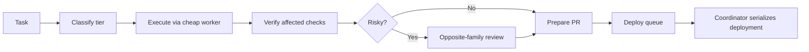

# Coding Agent Playbook

[](https://github.com/migelizaga-rgb/coding-agent-playbook/actions/workflows/ci.yml)

A practical, copyable operating system for coding agents: keep routine work fast, make risky work reviewable, and carry changes through verification and coordinated deployment. The playbook combines repo instructions, reusable skills, compact command wrappers, a deploy queue, handoff tooling, and tests without requiring runtime services or third-party packages.

## The problem

Coding agents drown in logs when every command dumps raw output into the conversation. They over-review tiny changes, under-review risky ones, stop at “needs human review” without finishing useful branch work, and can deploy concurrently when each worker acts alone. The result is slow feedback, expensive context, unclear evidence, and avoidable production risk.

This repository gives teams a small set of defaults that address those failure modes while leaving project-specific commands and approval rules with each project.

## What’s inside

| Folder | Purpose |
|---|---|
| `docs/` | Work tiers, review rules, handoff, branch finishing, deployment, token efficiency, and reusable evidence/spec formats. |
| `templates/` | Starting instructions for repositories and a small indexed workspace knowledge example. |
| `skills/` | Five installable skills for handoff, review, delegation, specification, and plan review. |
| `bin/` | A Node.js standard-library CLI for reading and writing compact handoffs. |
| `scripts/` | Compact run/deploy wrappers, deploy queue coordinator, installer, and workflow audit. |
| `config/` | Example local settings snippets with role-oriented defaults. |
| `tests/` | Shell policy and runner checks plus JavaScript coordinator and handoff lifecycle tests. |
| `.github/workflows/` | CI on Ubuntu with Node.js 22 and no secrets or self-hosted runners. |

## The loop



## What it looks like

A 401-line test run that fails once. The agent sees eight lines; the full log
stays on disk, and the original exit code is preserved:

```text
$ bash scripts/agent-run-compact.sh --name unit-tests --tail-lines 4 -- npm test
[agent-run] unit-tests: starting
[agent-run] unit-tests: full log -> artifacts/agent-run/20261126T034341Z-26515-unit-tests.log
[agent-run] unit-tests: exit=1 duration=1s log=artifacts/agent-run/20261126T034341Z-26515-unit-tests.log
[agent-run] unit-tests: failure tail (last 4 lines)
ok 400 - case 400
not ok 401 - parses empty config
  AssertionError: expected {} got undefined
# tests 401 pass 400 fail 1
$ echo $?
1
```

A handoff that a different agent (or a fresh session after compaction) can
resume from. Checkpoints refuse to record a milestone without evidence:

```text
$ agent-handoff checkpoint --milestone "Retry with jitter implemented" --status "Focused tests pass" --next "Open PR"
agent-handoff: checkpoint requires at least one --evidence "..."

$ agent-handoff checkpoint --milestone "Retry with jitter implemented" --status "Focused tests pass" \
    --evidence "npm test -- webhook: 12/12 pass" --next "Open PR"
$ agent-handoff read
# Agent Handoff - Current

Status: Focused tests pass
Task: main
Branch: main
Head SHA: 168a62a163e5ba85e085e21bac687e3378315a06
Objective: Add retry to webhook sender
Current checkpoint: Retry with jitter implemented
Next action: Open PR
...
## Checkpoints
- 2026-11-26T03:43:23Z - started - inline note
- 2026-11-26T03:43:42Z - Retry with jitter implemented - docs/handoff/checkpoints/2026-11-26-retry-with-jitter-implemented.md
```

`read` also warns when the recorded branch, worktree or HEAD no longer match the
checkout, so a stale handoff is flagged instead of silently trusted.

## Design choices

- **Tier work by effect, not file count.** A one-line approval or runtime change can be riskier than a large documentation update.
- **Make tests the first evidence.** Independent review adds judgment that checks cannot supply; it is not ceremony for every edit.
- **Review risky work once, then bound repeats.** A fresh opposite-family reviewer inspects the final artifact, with one targeted repeat after a material fix.
- **Reuse valid receipts.** Unchanged content does not need another review or test run just because it is being committed or pushed.
- **Finish branches by default.** Human review usually gates deployment or cutover, while ready branch work can continue through its assigned finish steps.
- **Serialize deployments.** Workers enqueue intent; the coordinator batches eligible intent with deduplication and locks to prevent concurrent deploy execution.
- **Keep context lean.** Compact wrappers preserve full logs on disk, summarize useful signals, and return the original exit code. Handoffs record milestones rather than every command.

## Quick start

Copy the templates that fit your workflow into a repository:

```bash
cp templates/AGENTS.md /path/to/repo/AGENTS.md
cp templates/CLAUDE.md /path/to/repo/CLAUDE.md
mkdir -p /path/to/repo/workspace
cp templates/workspace-AGENTS.md /path/to/repo/workspace/AGENTS.md
```

Install the skills into your assistant's skill directory, preserving each directory name:

```bash
mkdir -p ~/.claude/skills
cp -R skills/* ~/.claude/skills/
```

Put the handoff CLI on your `PATH`, or call it from the repository:

```bash
export PATH="$PWD/bin:$PATH"
agent-handoff start --objective "Describe the work" --next "Run the focused check"
```

Install the reusable scripts into a repository when useful:

```bash
bash scripts/install-to-repo.sh /path/to/repo
```

Adapt deployment commands and approval rules before enabling live coordination. The default queue lives in `.deploy-coordinator/`; use `DEPLOY_COORDINATOR_DIR` to move it. The coordinator command is configured with `DEPLOY_COORDINATOR_DEPLOY_CMD`.

Run the full local checks from the repository root:

```bash
for test in tests/*.sh; do bash "$test"; done
for test in tests/*.js; do node "$test"; done
```

## Policy at a glance

| Situation | Default response |
|---|---|
| Small, obvious edit | Make the change, inspect it, and run one focused check. |
| Bounded implementation | Record intent and acceptance, run affected tests, and inspect the diff. |
| Security or runtime impact | Write a compact spec and request one independent opposite-family review. |
| Long or noisy command | Capture full output in an ignored log and show only bounded signals. |
| Work spans sessions | Maintain a short current handoff and checkpoint at milestones. |
| Eligible change is merged | Enqueue deployment intent for the designated coordinator. |

## Using the deploy queue

The queue stores one record per merged revision and deduplicates repeated requests. Batch size and idle time let related changes move together without making every worker hold a deployment lock. An urgent item can run immediately. A dry run shows what would be selected without mutating queue state.

The coordinator acquires a queue lock while selecting work, then a deployment lock while the configured command runs. Lock age is bounded so abandoned locks can be recovered. Failed batches are recorded for inspection, and the command exit status is retained in the result. Set environment overrides deliberately and keep the queue on storage appropriate for your coordinator.

## Handoffs and retrieval

`bin/agent-handoff` stores the current pointer in the repository and milestone history under `docs/handoff/checkpoints/`. The `read` command reports whether the task, branch, worktree, and revision still match. `start` establishes identity; `checkpoint` requires evidence; `close` records closure evidence. All defaults stay relative to the current repository.

The knowledge example separates always-read rules from contextual notes. The index makes focused retrieval possible without loading every note. Keep durable knowledge generic and evidence-backed, and keep temporary task details in the handoff instead.

## Adaptation points

This repository supplies templates, not a universal policy engine. Replace example commands with your test and deployment commands. Tune output limits to your tools, define who can approve protected actions, and choose model providers for the three worker roles. Keep project-specific authority in the project instructions so a shared template does not silently override it.

The CI workflow runs on a standard hosted Ubuntu runner with Node.js 22. Scripts use the Node.js standard library; the repository does not require package installation. Local tests create temporary repositories and scratch logs, then clean them up.

## Results

This playbook was extracted from a private, solo-maintained agent platform built
with Claude Code and Codex under these rules. Over eight months that project
reached:

- **3,300+ merged pull requests** and about **6,200 commits** on a protected `main`
- about **1,000 test files** gating CI

The numbers describe sustained volume, not quality on their own. The tiers exist
so that volume stays reviewable: most changes take a fast path, and only the
risky ones pay for an independent review.

## Why I built this

Once coding agents were writing most of my code, my bottleneck stopped being
typing and became attention: logs filling the context, a full review on a typo
while a deploy change slipped through, sessions stalling at "needs human
review." Each rule here started as a fix for a failure I hit more than once.
I'm sharing it because the hard part of agentic engineering isn't the model.
It's the operating discipline around it.
